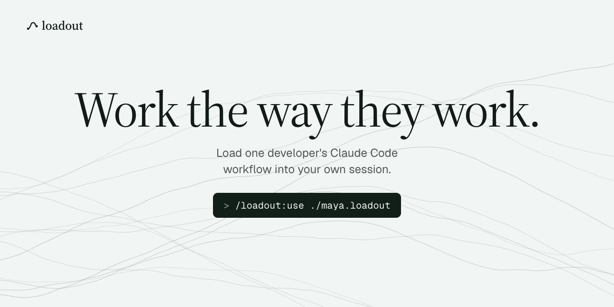
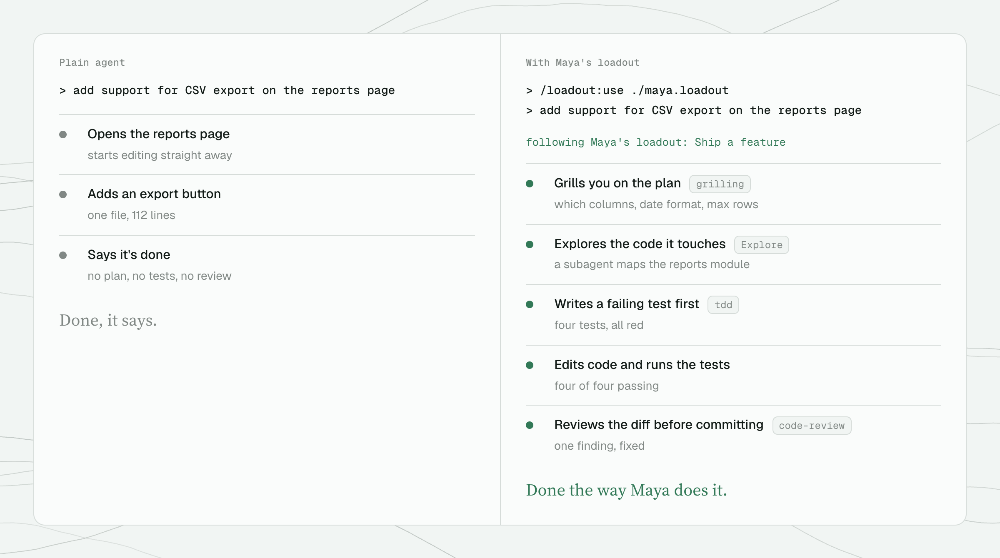
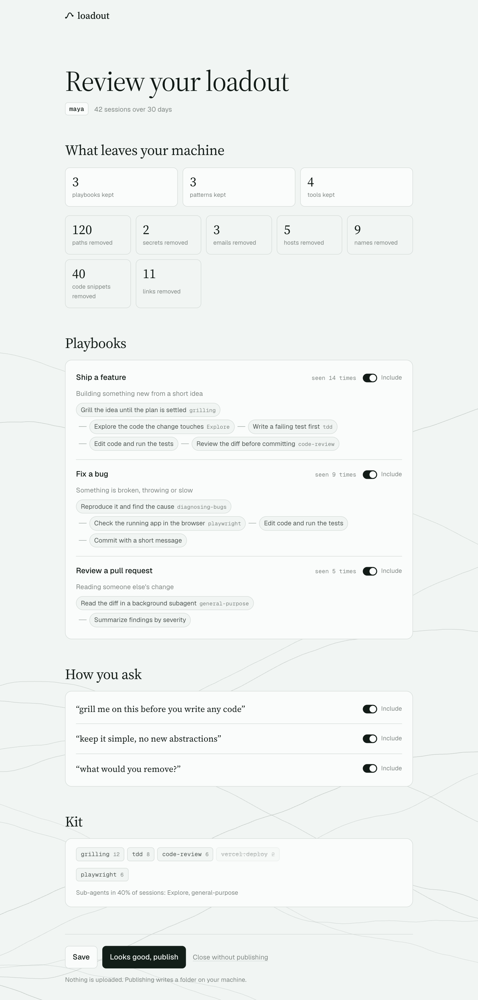

<p align="center">
  
</p>

<h1 align="center">loadout</h1>

<p align="center">Work the way they work.</p>

A loadout is how one developer works with Claude Code, packed into a folder you can load with one command. It holds their playbooks (for each kind of task, the skills, subagents and tools they reach for, in order), the way they ask, and their kit. It's mined from the owner's own sessions on their machine, and they review every line before they share it.

Team memory tools collect what a group knows about a codebase. A loadout is narrower: one person's way of working, ported to your session. Not their code and not their coding style, only the workflow around it.

## See it

Same prompt, same repo. On the right, Maya's example loadout is on.

<p align="center">
  
</p>

## Try it in 30 seconds

In Claude Code:

```
/plugin marketplace add jcodebreaker/loadout
/plugin install loadout@loadout
```

Then load the example that ships with the plugin:

```
/loadout:use maya
```

Ask for something like "add support for CSV export on the reports page". Claude follows her rules and offers her **Build a feature** playbook, with its steps, before it runs any of them. Each playbook is offered once per session, and commit, push, PR and deploy steps still wait for your OK. `/loadout:off` puts things back. Needs Node 22 or later.

## Make your own

**Build.** Read your Claude Code sessions from `~/.claude/projects` (the last 30 days by default) and find your playbooks:

```sh
npx github:jcodebreaker/loadout build          # or: node bin/loadout.mjs build
```

**Review.** `build` opens a local page with everything it found. Switch off what you don't want to share and rename playbooks. The top of the page shows what will leave your machine and how much was removed.

<p align="center">
  
</p>

**Publish.** Press publish, or run `loadout publish`. It writes `<you>.loadout/`, a plain folder. Share it however you like.

Your handle defaults to your git `user.name`.

## What's in a loadout

```
maya.loadout/
  loadout.json    the data
  LOADOUT.md      what Claude reads
  README.md       a short card for people
```

`LOADOUT.md` is short and plain. From [the example](docs/example/maya.loadout/LOADOUT.md):

```md
## Rules they've enforced

Follow these. They come from times Maya had to correct an agent.

- Don't add comments that restate the code.
- Run the test you wrote before you edit anything else.
- Ask before adding a dependency.

## How they check work

- Run the tests after the last edit and before committing (they do this in 7 of 10 feature tasks).

## How they open a task

- Before starting, restate what done looks like and confirm it (their openings say it 19% of the time).
```

- **Rules they've enforced.** Mined from the moments the owner corrected an agent: "no", "stop", "don't", "you forgot", an interrupt, a rejected tool call. Corrections Claude Code saved to auto-memory (`feedback` memories) join them, on in review unless they name one of the owner's repos (`--no-memory` skips them). This is the part that matters most, so it comes first and is never trimmed.
- **How they check work.** Their verification habits with honest rates: tests before committing, checking in the browser on UI work, asking for proof.
- **How they open a task.** How long their first message is, whether they attach a spec or screenshot, name files, say what done looks like. Turned into guidance for the agent.
- **Playbooks.** For each kind of task, the skills, subagents and MCP servers they reach for, in order.
- **How they ask** and **Kit.** Phrasings they repeat, and the tools behind the playbooks, with where each comes from and how to install it.
- **Their CLAUDE.md**, redacted, only if they switch it on.

## Does it help?

A small pilot in [docs/ab.md](docs/ab.md): three tasks on a toy repo, two runs each, with and without Maya's loadout, on Sonnet.

| | plain | with loadout |
| --- | --- | --- |
| Ran the tests | 2 of 6 | 5 of 6 |
| Ran the tests after the last edit | 2 of 6 | 5 of 6 |
| Added or changed a test | 2 of 6 | 4 of 6 |
| Passed a hidden check | 6 of 6 | 6 of 6 |
| Cost | $0.40 | $0.59 |

The outcome was the same: the tasks were too easy to separate the arms. The process changed: with the loadout, Claude checked its work more often and wrote regression tests, at about 50% more cost. Twelve runs is a pilot, not proof. `node scripts/ab.mjs` reruns it.

## Things to say

In Claude Code, with a loadout on:

- **"Use Maya's loadout."** `/loadout:use maya`. New sessions keep it until you turn it off. It lists the plugins and skills of hers you don't have, with the lines to install them; `loadout skills maya --yes` copies the skills she bundled, after you've seen them.
- **"That rule is wrong here, forget it."** Drops one rule, check or playbook, for you only. "Not this time" just skips it once.
- **"Bring it back."** Lists what you forgot and restores it.
- **"Which loadout is on?"** `/loadout:status`
- **"Back to normal."** `/loadout:off`
- **"Is loadout set up?"** `/loadout:doctor` checks it and says what to do next.
- **"Keep this session out of my loadout."** `/loadout:incognito`

If you forget something in your own loadout, it is switched off in your draft too. Publish again to share the fix.

## Recall

When a prompt is clearly about work you did before, Claude gets a short note from your own past sessions: what you asked, the steps, what you corrected and decided, how it ended. You see one line: `loadout recalled: <that task>`. Each past task comes up once per session, never from the session you're in, and not on follow-ups, chat or slash commands. It works with or without a loadout on.

- **"What did I decide about the webhook retries?"** `/loadout:recall webhook retries`
- **"Have I done this before?"** / **"How did I do this last time?"** Claude looks it up.
- **"Stop recalling."** `loadout recall off` (`on` brings it back).

The index of your past tasks stays on this machine, is never packed or published, and keeps no secrets.

In a terminal:

```
loadout use <handle|path>      loadout off      loadout status      loadout list
loadout forget [ref|words]     loadout restore [ref]     loadout doctor     loadout incognito <session-id>
loadout suggest ask|auto|off   offer a matching playbook (default), follow it without asking, or send none
loadout recall "<words>"       what happened last time      loadout recall on|off
loadout build [--handle maya] [--since 30d] [--llm] [--no-memory] [--no-claude-md] [--no-review]
                                                                     mine your sessions and memory into a draft
loadout review [--handle maya]                                       reopen the review page
loadout publish [--handle maya] [--out .]                            write <handle>.loadout
loadout recall --reindex [--since 90d]                               rebuild the recall index
```

## Privacy

- Everything runs on your machine. Nothing is uploaded, and there is no server.
- Pastes, system reminders, IDE blocks and images are dropped before anything else. Paths, secrets, emails, hostnames, names, code and URLs are redacted before mining and again on the result. Only the counts of what was removed are kept.
- `--llm` is opt-in: it asks your own `claude -p` to name and describe playbooks. Without it, mining is deterministic and offline.
- `/loadout:incognito` keeps a session out of every later `build`, for work that isn't yours to share, and out of recall.
- Recall indexes your past tasks in `~/.loadout/recall/` when a session ends. It keeps your words but never keys or tokens, and is never packed or published.
- You see every line before it leaves, on the review page.

**Only load loadouts from people you trust.** A loadout is instructions to your agent. Read its `LOADOUT.md` first: it's short and plain text. Your own instructions always win over a loadout.

## Under the hood

```
~/.claude/projects/*.jsonl ──▶ src/sessions.mjs   prompts, skills, subagents, MCP, tools (names only)
                                     │
                                     ▼
                               src/redact.mjs     drop pastes, redact private data, keep counts
                                     │
                                     ▼
                               src/mine.mjs       opening prompt → ordered steps = a playbook
                                     │
                                     ▼  review page, then publish
                               src/pack.mjs       loadout.json + LOADOUT.md
                                     │
                                     ▼  /loadout:use
                               hooks/             SessionStart: the whole LOADOUT.md, once
                                                  UserPromptSubmit: offers the matching playbook
```

- **Sessions** are read line by line. The format is internal to Claude Code, so unknown lines are skipped and a broken file never stops a build. Tool inputs are read only to classify a call and are never stored.
- **Mining** groups opening prompts by kind and keeps the skills, subagents and MCP servers used in that turn, in order. A phrasing becomes a pattern only when it shows up in at least two sessions.
- **The hooks** stay quiet when no loadout is on. `LOADOUT.md` is capped at 8 KB and a single playbook at 2 KB, so a loadout never crowds your context.

## Develop

```sh
git clone https://github.com/jcodebreaker/loadout && cd loadout
claude --plugin-dir .
npm run check                  # offline checks, invented fixtures only
```

Fixtures and examples are invented. Maya is made up.

## Roadmap

- [ ] Codex sessions, once they record tool calls locally
- [ ] Git history as a second source: how they branch, commit and review
- [ ] A gallery of loadouts people choose to publish

MIT.
